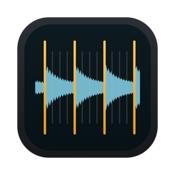

# Studio Tools

Free Mac tools for recording and producing music, made in a working studio to take
the slow, fiddly steps out of getting a song from a rough recording to a finished
production.

Each tool is a stand-alone app for Macs with Apple silicon (M1 or later), signed and
notarized by Apple, and runs entirely on your Mac: nothing you open in them is uploaded
anywhere.

---

### [OnTheGrid](onthegrid/)

**Put a song recorded without a click onto a steady tempo.** Drop in a rough recording
(voice and guitar or piano, a rehearsal, a live take; WAV or MP3) and get back the song
and its stems on a whole-number tempo, ready to drop into your DAW at zero and build on:
with a tempo map, the song's sections, its chords, and optionally a REAPER project.

[Guide](onthegrid/) · [Download the latest version](https://github.com/musicdemo/StudioTools/releases?q=onthegrid&expanded=true) · [What's new](onthegrid/CHANGELOG.md)

 

---

### [FirstPass](firstpass/)

**A reference mix from a folder of stems, in minutes.** FirstPass works out what each
track is, prepares it (polarity, gating, filtering, EQ, compression, level, pan) and gives
you a balanced mix on a virtual console you can adjust, bounce, or open in REAPER or
Pro Tools.

[About FirstPass](firstpass/) · *Downloads coming soon*

 

---

### Installing any of the tools

1. Download the `.dmg` from the tool's latest release.
2. Open it and drag the app onto **Applications** (choose **Replace** when updating).
3. Open the app from Applications.

The apps check for new versions themselves: when one is out, an alert appears in the
app's toolbar with what's new and a download link.
