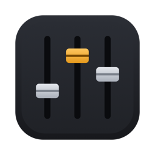

# FirstPass

**A reference mix from a folder of stems, in minutes.**

Before you can judge an arrangement, send a rough to a client or start the real mix,
someone has to get every track up on a console and make it sound like a record: flip the
polarity on the bottom snare mic, gate the toms, high-pass everything that isn't bass, set
the compressors and find a balance. That's an hour of routine before the interesting part.

FirstPass does that part. Point it at a folder of stems and it:

- **analyses** every track (loudness, dynamics, noise floor, spectrum) and finds the song's
  tempo and key,
- **works out what each track is** (kick, snare, overheads, bass, guitars, keys, lead and
  backing vocals…), from its name or its sound,
- **prepares every track** the way you'd start it yourself: polarity between related mics,
  input trim, high-pass, gate or expander, EQ, compression, pan and level, with the reason
  for each decision shown on the track's strip,
- **balances the mix:** bus and master compression, the master level at your loudness
  target, and a limiter.

Then adjust anything on the console, compare it with a reference mix, **bounce** it, or
carry on in **REAPER** or **Pro Tools**.

[Download the latest version](https://github.com/musicdemo/StudioTools/releases?q=firstpass&expanded=true) ·
[What's new](CHANGELOG.md)

**Runs on** Macs with Apple silicon or Intel. Everything happens on your Mac: your stems are
never uploaded anywhere.

---

## Contents

- [Installing](#installing)
- [Quick start](#quick-start)
- [The console](#the-console)
- [Reverb](#reverb)
- [Bouncing](#bouncing)
- [Projects](#projects)
- [Exporting](#exporting)
- [Exporting to REAPER](#exporting-to-reaper)
- [Exporting to Pro Tools](#exporting-to-pro-tools)
- [Settings](#settings)
- [Tips and troubleshooting](#tips-and-troubleshooting)
- [Video tutorials](#video-tutorials)

---

## Installing

1. Download `FirstPass-<version>.dmg` from the
   [latest release](https://github.com/musicdemo/StudioTools/releases?q=firstpass&expanded=true).
2. Open it and drag **FirstPass** onto **Applications** (choose **Replace** when updating).
3. Open FirstPass from Applications.

When a new version is out, an alert appears at the right of FirstPass's toolbar: click it
to see what's new and download it. **FirstPass › Check for Updates…** checks right away.

## Quick start

1. Choose **File › New Session from Stems…** (⌘N) and pick the folder with the song's stems,
   one file per track: WAV, AIFF or FLAC.
2. FirstPass analyses and prepares every track, then shows what it found and did: the tempo
   and key, mics it treated as pairs, polarity flips, time alignment, gates and the master
   settings. **Mix › Preparation Report** (⌘I) shows it again.
3. Press **space** to play, and adjust anything you like.
4. **File › Save** (⌘S) to keep the session, then **BOUNCE** a mix or export it to your DAW.

A full mix in the folder (named like `RUFF MIX` or `rough mix`, or any MP3, M4A or OGG file)
is kept out of the mix and put on the **REF** button, level-matched, so you can compare.
Click and guide tracks are recognised and muted.

If the folder name includes the tempo ("My Song 96bpm" or "My Song - 96"), FirstPass uses
it; otherwise it works the tempo out from the playing.

## The console

Every track has a strip, grouped into busses (drums, percussion, bass, guitars, keys, lead
vocal, backing vocals). The bus and reverb faders (blue caps) come after the tracks; the
master (red) stays pinned on the right.

- **Role menu** at the top of each strip: what FirstPass thinks the track is. Amber means a
  guess worth checking; choose the right role and the track is prepared again for it.
- **Strip:** EQ curve, gate and compressor activity, polarity, reverb sends, width, pan,
  mute, solo and fader.
- **Detail panel:** click a strip's name to see every setting, adjust it, and read why each
  automatic decision was made.
- **WIDTH** (mono tracks): spreads a mono part across the stereo field with a short delay on
  one side. The amount, the delay and which side is delayed are in the detail panel.
- **Tone presets** in the EQ panel for kick, snare, bass and lead vocal: switching between
  them is level-matched, so you hear the tone and not a change in level.
- **REF** (toolbar): listen to the reference mix at matched loudness.
- **PROC** (toolbar): hear the mix with and without processing.
- **TARGET** (toolbar): the loudness the master is set to, from –18 to –10 LUFS.
- **MONO** (master strip): check the whole mix summed to mono.
- **Mix › Re-mix from Scratch…** runs the automatic preparation again (it asks first).
- **Mix › Swap Drum Perspective** mirrors the drum panning between the drummer's view
  (hi-hat on the left) and the audience's view (hi-hat on the right).

Drag knobs and value boxes up and down (hold Shift for fine control), double-click a knob or
fader to reset it, and press space to play and stop.

## Reverb

Each reverb return can be a **plate** or a **room**, chosen in the return's panel; the strip
shows which.

- **Pre-delay** and **decay** can follow the song's tempo, so the reverb breathes with it.
- The room has **size** and **early reflections** controls.
- **Ducking** is built in: the reverb dips while the lead vocal sings and blooms in the gaps,
  so the vocal stays clear without losing the space.

## Bouncing

**BOUNCE** (⌘B) renders the whole song and opens the bounce window:

- Drag the **START**, **FADE** and **END** markers on the waveform to trim the bounce and set
  where the ending starts. Click the waveform to listen from there.
- **Ending:** fade out the tails, or a long fade-out for songs that end on a loop or vamp.
- **Fade-in** for the start.
- **Format:** 24-bit or 16-bit WAV, or 320 kbps MP3.

The save dialog starts in the project's `Bounces` folder. A mix sheet listing every setting,
and the reason for it, is saved next to the bounce. Your bounce choices are remembered with
the session.

## Projects

**File › Save** (⌘S) keeps the session in a project folder, normally
`Documents/FirstPass Projects/<song>/`:

| File | What it is |
|---|---|
| `<song>.firstpass` | every decision and setting, so the console reopens exactly as you left it |
| `Media/` | copies of the stems (the originals are never changed) |
| `Bounces/` | your bounces and their mix sheets |
| `<song> - FirstPass.RPP` | the REAPER project, if you exported one |
| `<song> - FirstPass/` | the Pro Tools session, if you exported one |

**File › Open Project…** (⌘O) and **Open Recent** carry on where you left off; double-clicking
a `.firstpass` file in Finder opens it too. **Save As…** copies the project to a new folder.
FirstPass asks before closing a session with unsaved changes.

## Exporting

Both exports open a window where you choose what's included. Track order, folders and colours
always come along. **Sounds like FirstPass** ticks everything; **Organised stems only** keeps
just the alignment, the reference and the tempo. FirstPass remembers your choices for each DAW.
**Polarity and time alignment** is marked *recommended*: it keeps related microphones in phase.

## Exporting to REAPER

**File › Export to REAPER…** (⌘E), or the **REAPER** button, saves the mix as a REAPER project
in the song's project folder and opens it in REAPER. Everything is ticked by default:

- **Polarity and time alignment**: REAPER's polarity buttons and the items' start offsets.
- **Faders and pans**, and **mutes**, on REAPER's own controls, so automation works as usual.
- **Channel processing**: every channel carries the **FirstPass Channel** plugin with the
  console's settings, with **Filters**, **Gates**, **EQ** and **Compression** each on or off
  (unticked stages are in the plugin, switched off, so you can turn them on later).
- **Bus and master processing**: bus compression, the master compressor and limiter.
- **Reverbs**: the plate and room tracks with **FirstPass Reverb**, and the sends to them.
- The **reference mix** (a muted, level-matched track at the bottom) and the **tempo**.

Busses are folder tracks with their tracks inside, and the project runs at the session's
sample rate. A project can have **no FirstPass plugins at all**: each track's input trim is
then set on its item, so the faders still give the console's balance.

The plugins are installed into REAPER with any export that uses them. **File › Install REAPER
Plugins** installs them without exporting, for a Mac that will open projects exported
elsewhere. REAPER 7.45 or later is recommended.

## Exporting to Pro Tools

**File › Export to Pro Tools…** (⇧⌘E) builds the session in Pro Tools itself. It needs
**Pro Tools 2025.10 or later**, running, with no session open; FirstPass offers to open it.
The session goes in the song's project folder, with a **folder per bus**, its tracks inside
in console order, coloured by bus. The audio is 32-bit float, so nothing clips.

By default you get clean, aligned stems:

- **Polarity and time alignment** and the **input trim**, written into the audio (so Pro
  Tools' polarity buttons stay off);
- **mutes** as on the console;
- a muted **FIRSTPASS MIX** track with the console's full mix, the **reference**
  (muted, level-matched), and a **marker at the start** with the song's tempo.

You can also **print processing into the audio**: **Filters**, **Gates**, **EQ** and
**Compression**, each only on the tracks where it's switched on. Tick **Gates** alone, for
example, to get just the gated tracks gated and everything else clean. Printed processing
always includes the trim, since the console set it for the trimmed signal; compression was set
for the EQ'd signal, so without EQ it acts differently. **Reverb returns** can be printed as
tracks too (off by default).

Some things Pro Tools doesn't yet let another app set:

- **the tempo:** set it from the marker (the session opens at 120 BPM; the audio stays put
  when you change it);
- **faders and pans** start at unity. The console's values are in **`FirstPass levels.txt`**
  in the session folder, with what's in each file (trim, polarity, printed processing); with
  the trims in the files, the fader values give the console's balance as they are;
- **routing:** the folders organise the tracks, but every track plays straight to the main
  output.

Exporting the same song again makes a new numbered session beside the old one. **Pro Tools
Intro** allows only 8 audio tracks, so most songs need Pro Tools Artist or Studio.

## Settings

**FirstPass › Settings…** (⌘,) sets, for new sessions:

- **Drums panned from** the drummer's view or the audience's view;
- the **loudness target**.

## Tips and troubleshooting

- **A track is treated as the wrong instrument:** choose the right role in the menu at the
  top of its strip.
- **Name your stems clearly** ("Kick In", "Snare Bot", "OH L", "Bass DI", "Lead Vox"): names
  are the most reliable way FirstPass tells tracks apart.
- **Put the tempo in the folder name** if the song's tempo varies or FirstPass gets it wrong.
- **A stem was taken for the reference mix:** stems should be WAV, AIFF or FLAC; MP3, M4A and
  OGG files are treated as reference mixes.
- **Export to Pro Tools says Pro Tools isn't open:** start Pro Tools (2025.10 or later),
  close any open session, and try again.
- **REAPER can't find the FirstPass plugins:** use **File › Install REAPER Plugins**, then
  reopen the project.

## Video tutorials

Coming soon.
